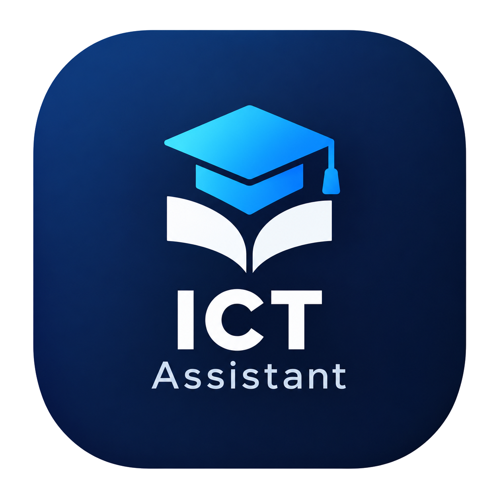

# 📱 ICT Assistant

**এইচএসসি আইসিটি সম্পূর্ণ অফলাইন সহায়িকা — Complete Offline HSC ICT Companion for Android**

[-2563EB?style=for-the-badge&logo=android&logoColor=white)](https://github.com)
[-3DDC84?style=for-the-badge&logo=android&logoColor=white)](https://www.android.com)

*An all-in-one, offline-first educational Android application built for HSC ICT students in Bangladesh — featuring structured Chapters 1–6, interactive simulators, built-in offline C & HTML/CSS/JS IDEs, a live C algorithm stepper, an SQL lab, and board-standard exam practice.*

---

## ✨ Key Highlights

- **100% Offline Ready** — Study all 6 chapters, run C code, preview HTML/CSS/JS pages, simulate networks & logic gates, and take mock exams anywhere without internet access.
- **Modern Material 3 Interface** — Clean, distraction-free reading experience with edge-to-edge layout, dark/light theme support, and smooth navigation.
- **All-in-One Practice Labs** — No need for separate compiler or simulator apps; test C programs, web pages, logic circuits, number conversions, and SQL queries right inside the app.
- **Smart Progress Tracking** — Bookmark important topics, save personal study notes, and track quiz scores and chapter mastery over time.

---

## 📚 Curriculum Coverage (Chapters 1–6)

Organized sequentially to match the official **HSC ICT Board Syllabus**:

| Chapter | Title (বাংলা) | Key Topics |
| :---: | :--- | :--- |
| **Chapter 1** | তথ্য ও যোগাযোগ প্রযুক্তি: বিশ্ব ও বাংলাদেশ প্রেক্ষিত | Global Village, Virtual Reality, AI, Robotics, Cryosurgery, Biometrics, Bioinformatics, Genetic Engineering, Nanotechnology & ICT Ethics |
| **Chapter 2** | কমিউনিকেশন সিস্টেমস ও নেটওয়ার্কিং | Data Transmission Modes, Bandwidth, Wired & Wireless Media, Network Topologies, Networking Devices & Cloud Computing |
| **Chapter 3** | সংখ্যা পদ্ধতি ও ডিজিটাল ডিভাইস | Number Systems (Binary, Octal, Decimal, Hex), 1's & 2's Complement, BCD/ASCII/Unicode, Boolean Algebra, De Morgan's Laws, Logic Gates, Adders, Encoders, Decoders & Flip-Flops |
| **Chapter 4** | ওয়েব ডিজাইন পরিচিতি এবং HTML | Website Structure, IP & Domain, HTML Tags, Lists, Tables, Hyperlinks, Images, Forms, CSS Styling & Web Publishing |
| **Chapter 5** | প্রোগ্রামিং ভাষা | Programming Fundamentals, Algorithms, Flowcharts, C Syntax, Data Types, Conditions, Loops, Arrays, Functions & Board Problem Solving |
| **Chapter 6** | ডেটাবেজ ম্যানেজমেন্ট সিস্টেম | DBMS & RDBMS Concepts, Keys (Primary, Foreign, Composite), SQL Queries (`SELECT`, `INSERT`, `UPDATE`, `DELETE`, `JOIN`), Sorting, Indexing & Data Security |

---

## 🧪 Built-in Simulators & Offline IDEs

- **💻 Offline C Compiler IDE** — Syntax highlighting, synchronized line numbers, undo/redo, auto-indent, font-size controls, live error line markers, compiler hints, and interactive `scanf` / `printf` console.
- **⚙️ C Algorithm Simulator** — Dedicated step-by-step algorithm simulator with custom inputs, live line stepping, and real-time variable tracking.
- **🌐 HTML / CSS / JS Playground** — Multi-tab offline web IDE with live preview, mobile/desktop viewport switcher, syntax highlighting, and console/error hints.
- **🔌 Digital Logic Gate Simulator** — Interactive **AND, OR, NOT, NAND, NOR, XOR, and XNOR** simulation with real-time truth tables.
- **🔢 Number System Converter Lab** — Instant conversion across Binary, Octal, Decimal, and Hexadecimal (including fractions) with step-by-step solution breakdowns.
- **🕸️ Network Topology Simulator** — Visual **Bus, Star, Ring, Mesh, Tree, and Hybrid** topologies with animated packet flow and realistic broken-cable/node fault simulation.
- **🗄️ SQL & DBMS Practice Lab** — Offline relational query execution and practice environment.
- **📝 Practice & Exam Suite** — Chapter-wise HSC board-aligned MCQs, timed model tests, flashcards, and detailed score analytics.

---

## 📦 Download & Installation (`v1.0.5`)

Choose the APK matching your Android device architecture from the **Releases** section:

| APK File | Architecture | Best For |
| :--- | :--- | :--- |
| `ICT-Assistant-1.0.5-arm64-v8a-release.apk` | `arm64-v8a` (64-bit ARM) | Modern Android phones & tablets *(Smallest size, recommended)* |
| `ICT-Assistant-1.0.5-armeabi-v7a-release.apk` | `armeabi-v7a` (32-bit ARM) | Older 32-bit Android devices |
| `ICT-Assistant-1.0.5-universal-release.apk` | Universal (All ABIs) | Any Android device running **Android 7.0+** (`API 24+`) |

### Installation Steps
1. Download the recommended APK for your device.
2. Open the `.apk` file and allow **Install from Unknown Sources** if prompted.
3. Launch **ICT Assistant** and start learning offline.

---

## 🆕 Highlights in `v1.0.5`

- Upgraded C & HTML/CSS/JS IDEs with syntax highlighting, synchronized line numbers, undo/redo, auto-indent, font-size controls, and live error hints.
- Added dedicated **C Programming Algorithm Simulator** with custom input and live step-by-step execution.
- Enhanced **Network Topology Simulator** with realistic broken-cable fault routing.
- Organized Chapters 1–6 sequentially, fixed subpage top spacing & splash icon delay, and refreshed the overall UI/UX.

---

## 📄 License & Copyright

This is a **closed-source, proprietary** Android application. All rights reserved by the author. Redistribution, decompilation, or unauthorized modification is prohibited.

---

## 👤 Developer

**Tasfiqul Alam Pabel**

*Made for HSC ICT learners across Bangladesh.*

